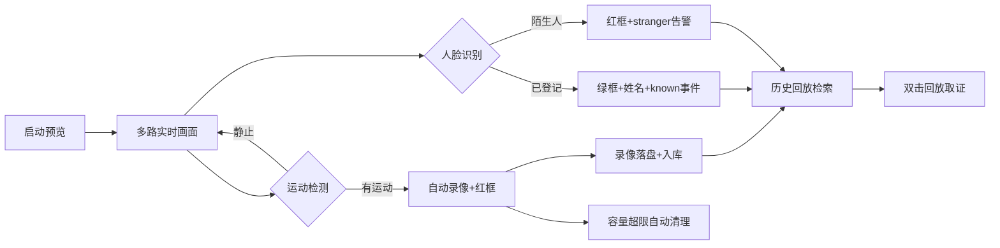

# 多路智能安防监控系统 — 项目描述

> 综合实训项目 · C++ / Qt / OpenCV / SQLite
> 文档定位：给评审、答辩、使用者看的「项目说明书」，重点讲清楚**用户视角的业务流程**：这个系统怎么用、每一步在做什么、解决了什么问题。

---

## 1. 项目概述

**多路智能安防监控系统**是一款桌面端安防监控软件，面向固定机位监控场景（办公室、门口、仓库、走廊等）。它把多路摄像头画面集中到一块九宫格界面，做到：

- **实时看**：多路画面同时预览，不卡顿；
- **异常录**：检测到运动自动录像，不用 7×24 小时录满硬盘；
- **智能认**：人脸识别，已知人员显示姓名，陌生人立刻告警；
- **自动理**：录像存储超限自动清理，无需人工运维；
- **事后查**：所有事件和录像都入库，可按类型检索，双击回放取证。

一句话概括：**一套「实时监控 + 异常录像 + 智能识别 + 历史回放」的完整业务闭环。**

技术栈：Qt 5.14.2（界面）、OpenCV 4.5.5（图像/视频/人脸）、SQLite（数据）、自研多线程架构（线程池 + 帧缓冲）。

---

## 2. 项目背景与目标

### 2.1 背景
传统监控录像机存在两个痛点：

1. **全时段录像浪费存储**——大多数时间画面是静止的，却一直在写盘；
2. **事后检索难**——几 GB 录像文件，要人工拖动找「出事的那一段」。

本项目针对这两个痛点设计：**事件驱动录像**（只在有运动时录像）+ **数据库索引回放**（事件、录像全部记录在案，按类型秒级定位）。

### 2.2 目标
- 综合运用课程知识点：多线程、线程同步、生产者-消费者、面向对象、设计模式（单例/多态）、数据库、OpenCV、事件驱动；
- 交付一个**能真实演示、有完整业务流程**的桌面系统，而不是零散的小例子。

---

## 3. 用户视角业务逻辑（核心章节）

这一章按「用户怎么一步步使用这个系统」来讲述，每步都说明**界面操作 → 系统内部在做什么**。

### 3.1 第一步：启动与准备

**用户操作**：打开程序 → 在工具栏选择路数（1/2/4 路）→ 勾选「运动检测」「人脸识别」开关 → 点击「启动预览」。

**系统内部**：
- 按路数创建通道：第 1 路默认摄像头，其余路可用视频文件代替（`--test` 模式下用合成测试源，无需摄像头也能演示）；
- 每路启动一个**采集线程**取帧、一个**消费线程**做检测，画面通过跨线程信号槽刷到九宫格；
- 若勾选人脸识别，加载 YuNet 检测模型 + ArcFace 识别模型（`w600k_mbf.onnx`，13MB、512 维特征），失败时自动禁用，不影响其他功能。

### 3.2 第二步：实时监控

**用户看到**：九宫格里每路画面实时刷新，右上角状态栏显示帧率；某路录制中时，该路画面出现红色边框。

**系统内部**：
- 采集线程取帧 → 放入**环形帧缓冲**（容量固定，满了丢最旧帧，宁可丢帧也保证实时）；
- 消费线程做帧差运动检测 + 预览帧转 QImage 直接上屏（预览不走线程池排队，永远是最新帧）。

### 3.3 第三步：异常自动处理（核心价值）

**场景 A：有人进入画面**
- 画面出现运动 → 系统**自动开始录像**（MJPG/AVI），该路红框亮起；
- 运动停止约 0.5 秒后录像自动收尾，文件落盘；
- 事件列表实时追加 `motion` / `motion_end`，数据库 `event` 表同步记录，`video_file` 表登记录像文件（起止时间、大小、路径）。

**场景 B：人脸识别开启**
- 人脸框**逐帧同步检测**（每路独立 YuNet 实例，框与画面严格对齐、无追尾延迟）；身份识别每 3 帧异步比对一次（共享线程池执行，不阻塞画面）；
- 检测到人脸：
  - **已登记人员** → 画面绿框 + 显示姓名，数据库记录 `known` 事件（识别带身份平滑：连续确认才切换，快速移动也不会闪成陌生人）；
  - **陌生人** → 画面红框 + `stranger` 标记，数据库记录 `stranger` 事件（5 秒节流防刷屏），并**自动截图存证**（每路 30 秒最多一张，保存到 `records/captures/`，事件类型 `stranger_capture`）。

### 3.4 第四步：登记人脸（让系统「认识」某人）

**用户操作**：让目标人出现在画面里 → 在输入框填姓名 → 点「登记人脸」→ 弹出**管理员验证**（账号 + 密码）→ 验证通过后完成登记。

**系统内部**：
- 首次运行自动创建管理员账号（默认 `admin` / `admin123`），密码加盐 SHA-256 存储，登录后可在验证框内「修改密码」；
- 登录状态本会话内有效，登记按钮旁有「管理员：未登录/已登录」提示；
- 取最近一次检测到的人脸 512 维特征（2048 字节）写入 `person` 表，同时加入内存人员库；
- 下次同一个人再出现，立刻变为绿框 + 姓名，不再报陌生人。
- 特征已持久化，**重启程序后依然认识**。

### 3.5 第五步：事后检索与回放取证

**用户操作**：点「历史回放」按钮 → 弹出检索窗口：
- 「事件记录」页签：按事件类型（online / motion / stranger / known…）过滤，查看时间、通道、详情；
- 「录像文件」页签：按类型过滤，列表带**首帧缩略图**，显示起止时间、大小；
- 双击任意一行 → 弹出回放窗口，播放/暂停/停止/拖动进度条。

**系统内部**：从 SQLite 的 `event` / `video_file` 表按类型查询（倒序 + 限量），事件与录像通过「事件详情 ↔ 录像路径」关联；缩略图由共享线程池异步生成，不卡界面。

### 3.6 第六步：存储自动治理（无人值守）

**用户不用管**：录像目录超过容量上限（默认 5GB，可配）时，系统自动从最旧开始删除录像文件，并同步清理数据库记录。

**三个检查时机兜底**：程序启动时、每段录像结束后、每 30 分钟定时器（防止某路连续运动时一直录不检查）。

### 业务闭环图



---

## 4. 核心功能清单

| 功能 | 说明 | 用户收益 |
| --- | --- | --- |
| 多路九宫格预览 | 1/2/4 路，摄像头/视频文件/测试源混用 | 一块屏幕看所有点位 |
| 运动检测自动录像 | 帧差法，有运动才录，静止自动停 | 省存储、好检索 |
| 人脸识别告警 | YuNet 检测 + ArcFace(w600k_mbf) 识别，陌生人红框、已知人员绿框+姓名 | 陌生人预警 |
| 陌生人自动截图 | 判定陌生人即保存现场帧，每路 30 秒一张，事件入库可检索 | 留证、事后追查 |
| 管理员权限 | 登记人脸需管理员登录（默认 admin/admin123，可改密），会话级有效 | 防止随意添加成员 |
| 人脸登记 | 输入姓名一键登记，特征持久化 | 系统越用越「认识人」 |
| 事件留痕 | 上线/运动/陌生人/登记等全部入库 | 事后可查、可追溯 |
| 历史检索与回放 | 事件/录像双页签、类型过滤、首帧缩略图、双击回放 | 秒级定位关键片段 |
| 存储容量治理 | 超限自动删最旧录像 + 同步清库 | 无人值守、不爆盘 |
| 测试模式 | `--test` 无需摄像头即可完整演示 | 答辩/演示零风险 |

---

## 5. 技术架构

### 5.1 分层设计

```
ui/      界面层     MainWindow、HistoryDialog、PlaybackWindow、mainwindow.ui
service/ 服务层     DatabaseManager（SQLite 单例，三表管理）
core/    核心层     线程池、帧缓冲、视频源、运动检测、录像器、存储治理、人脸分析
```

### 5.2 数据流（一路视频的完整旅程）

```
采集线程(取帧) ──→ 环形帧缓冲(满丢旧帧) ──→ 消费线程
                                              ├─→ 运动检测 → 是 → VideoRecorder 写盘
                                              ├─→ 预览帧直接转 QImage → 主线程上屏（不进线程池）
                                              ├─→ 人脸框逐帧同步检测（独立 YuNet）→ 主线程画框
                                              └─→ 每3帧异步识别 → 共享线程池 → 更新姓名/是否已知
录像/事件 → DatabaseManager(QMutex 保护) → SQLite(event / video_file / person)
```

### 5.3 关键工程点

- **自研线程池**：任务队列 `deque<std::function<void()>>` + 互斥锁 + 条件变量，8 个 worker；`submit/stop/drain` 接口，关窗安全收尾（0.5s 退出，无崩溃）；
- **生产者-消费者**：采集线程产帧、消费线程取最新帧，`shared_ptr<cv::Mat>` 零拷贝传帧；
- **跨线程 UI**：信号槽 `QueuedConnection`，界面永不卡顿；
- **人脸识别性能**：画框与识别解耦——框逐帧同步检测（每路独立 YuNet、无锁、约 5ms），识别每 3 帧异步比对（积压超 6 任务跳过本轮）；检测降采样 ≤640，画面保持实时；
- **多路共享分析器**：一个 `FaceAnalyzer` 共享实例做异步识别（内部互斥、省内存），每路另持独立 YuNet 只画框，互不阻塞。

---

## 6. 数据库设计

| 表 | 用途 | 关键字段 |
| --- | --- | --- |
| `person` | 人员库 | 姓名、512 维人脸特征 BLOB（2048 字节） |
| `video_file` | 录像文件 | 来源、路径、起止时间、类型、大小 |
| `event` | 事件记录 | 类型、来源、详情（录像路径/人名/截图路径）、时间 |
| `admin` | 管理员账号 | 账号、加盐 SHA-256 密码哈希、盐 |

> 数据文件 `demo.db` 首次运行自动创建；所有写操作加锁，跨线程安全。

---

## 7. 典型使用场景（演示故事线）

**场景：公司门口 / 办公室入口监控**

1. 启动 2 路（第 1 路摄像头，第 2 路放一段人流视频），开启运动检测 + 人脸识别；
2. 画面有人走动 → 现场演示：红框出现、录像自动开始、事件列表跳出 `motion`；
3. 视频中出现陌生人 → 红框 + `stranger` 告警事件；
4. 现场把视频中的人物登记为「张三」→ 再出现时绿框 + 张三，不再告警；
5. 停止预览 → 打开「历史回放」→ 按 `stranger` 过滤 → 双击录像回放取证；
6. 展示数据库：`event` 表完整留痕、`video_file` 表每段录像可查。

这条线走完，**实时监控、智能识别、自动录像、存储治理、事后取证**全部演示到，也对应了「多路 / 智能 / 安防监控」三个关键词。

---

## 8. 项目亮点与创新点

1. **事件驱动录像**：只在运动时录像，兼顾取证与存储效率（相对传统 7×24 录像的创新点）；
2. **陌生人识别告警**：把方案一（人脸考勤）的能力融进监控，识别陌生面孔并留痕；
3. **存储容量自愈**：多路并发写盘时的配额治理 + 数据库同步清理，三处兜底保证不爆盘；
4. **智能回放**：事件/录像入库检索 + 首帧缩略图 + 双击回放，替代人工拖进度条；
5. **自研多线程架构**：线程池、环形帧缓冲、背压丢帧策略——不是调库，是亲手实现的底层能力。

---

## 9. 完成情况与后续规划

**已完成（里程碑①—⑦，核心功能全部落地）**
- 框架搭建 → 多路九宫格预览 → 运动检测+事件驱动录像 → 存储容量治理 → 人脸识别告警 → 智能回放（历史检索+录像回放）→ 管理员权限 + 陌生人自动截图。

**可选加分项（未做）**
- 回放时间轴 + 关键帧标记（运动开始/陌生人帧）；
- 回放中运动时段高亮；
- 管理员登录失败锁定/操作日志；多级权限（普通用户/管理员）。

---

## 10. 运行环境与启动示例

**环境**：Windows + Qt 5.14.2（MinGW 64 位）+ OpenCV 4.5.5 + SQLite；人脸模型目录 `models/`（yunet 345KB + arcface w600k_mbf 13MB）。

```text
# 无摄像头完整演示：2 路测试源 + 人脸识别，自动开始
--test --channels 2 --autostart --face-dir models

# 摄像头 + 视频文件混用，录像限 1GB
--channels 2 --file "D:/videos/门口.avi" --max-storage 1024

# 历史查询自检（输出事件/录像清单后退出）
--history-dump
```

---

## 11. 结论

本项目以一个**真实可用的安防监控业务系统**为载体，把 C++ 课程的核心知识点串成了完整闭环：多线程与线程同步负责「多路并发不卡顿」，事件驱动负责「按需录像」，OpenCV 负责「看得见 + 认得出」，SQLite 负责「全程留痕可追溯」。既是技术练习，也是一个**拿得出手、讲得清楚、演得出来**的综合项目。
